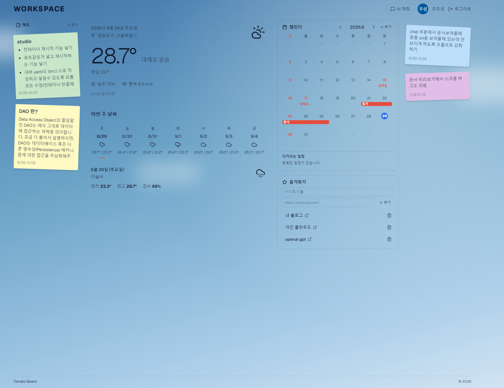
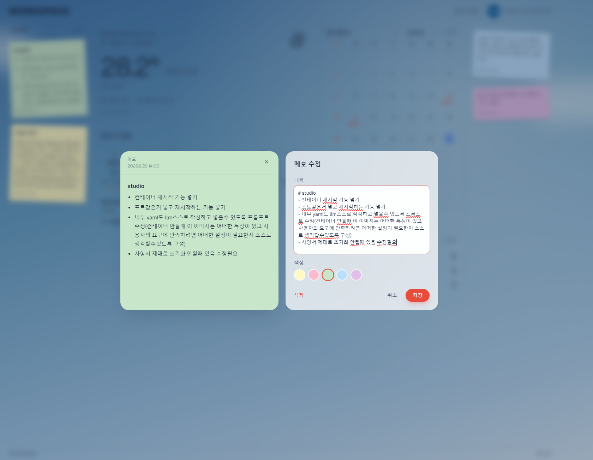
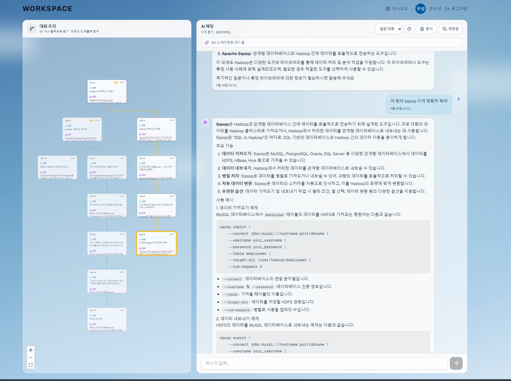
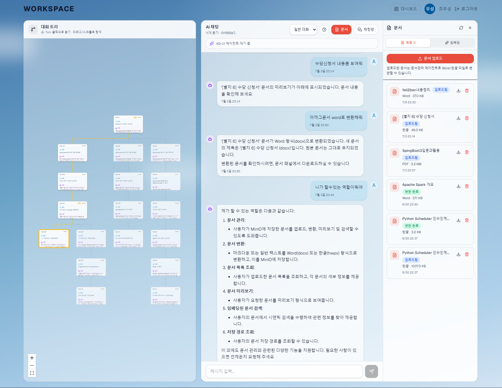
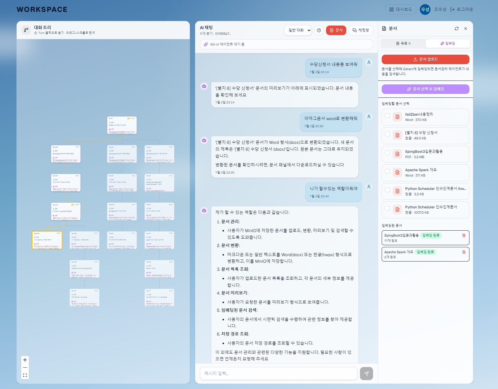

# Tomato Board

날씨로 물든 개인 워크스페이스. 일정·메모·즐겨찾기를 한 화면에 두고, 대화가 갈라져도 이어지는 AI 채팅으로 문서까지 다룹니다.

## 어떤 서비스인가요?

Tomato Board는 Google 계정으로 로그인하는 개인용 대시보드입니다.

오늘의 날씨가 화면 배경이 되고, 그 위에 캘린더·포스트잇 메모·바로가기 링크가 놓입니다. 같은 공간에서 AI에게 질문할 수 있고, 대화는 한 줄이 아니라 나무처럼 가지를 칩니다. 업로드한 문서는 Word·한글로 바꾸거나, 내용 기준으로 검색해 답변받을 수 있습니다.

## 대시보드

헤더에서 **대시보드**와 **AI 채팅**을 오갑니다. 대시보드는 현재 위치의 날씨에 맞춰 하늘 배경이 바뀝니다. 맑음, 구름, 비, 눈 등 날씨에 따라 색과 분위기가 달라집니다.

### 날씨

브라우저 위치를 기준으로 오늘 날씨와 주간 예보를 보여줍니다.

- 오늘: 기온, 체감 온도, 습도, 풍속, 위치
- 주간: 요일별 최고·최저 기온. 날짜를 골라 해당 날을 강조할 수 있습니다.

### 캘린더

월간 달력에서 일정을 만들고, 고치고, 옮깁니다.

- 날짜를 눌러 일정 추가, 기존 일정을 눌러 수정·삭제
- 제목, 시작·종료 시간, 설명
- 일정을 다른 날짜로 드래그
- 한국 공휴일은 달력에 자동으로 표시됩니다 (수정 불가)

### 메모

화면 왼쪽·오른쪽에 붙는 포스트잇입니다. 마크다운을 지원합니다.

- 색상 선택, 내용 작성·수정·삭제
- 드래그로 왼쪽/오른쪽 이동, 같은 쪽 안에서 순서 변경
- 좁은 화면에서는 가로 스크롤 목록으로 바뀝니다

### 즐겨찾기

자주 여는 사이트를 이름과 URL로 저장합니다. 목록에서 바로 새 탭으로 열 수 있습니다.

## AI 채팅

대시보드 헤더의 **AI 채팅**으로 들어갑니다. 왼쪽은 대화가 갈라진 모습(대화 트리), 오른쪽은 채팅창입니다.

### 채팅방

대화를 방 단위로 나눕니다. 새 방을 만들고, 목록에서 전환하거나 삭제할 수 있습니다.

### 대화 트리

일반적인 채팅처럼 한 줄로만 이어지지 않습니다. 이전 턴을 클릭한 뒤 다른 질문을 보내면, 그 지점에서 새로운 가지가 생깁니다.

- 턴을 클릭하면 그 경로의 대화가 채팅창에 표시됩니다
- 트리를 드래그·스크롤·확대해서 탐색할 수 있습니다

같은 주제를 여러 방향으로 나눠 보거나, 마음에 든 답변만 이어서 질문할 때 쓰입니다.

### 에이전트

채팅창에서 에이전트를 고릅니다. 비워 두면 **일반 대화**입니다.

| 에이전트 | 역할 |
| --- | --- |
| 일반 대화 | 학습·기획·일상 질문. 시사, 가격, 날씨처럼 시점에 민감한 내용은 웹 검색 후 답합니다. |
| 문서관리 | 업로드한 문서의 목록 조회, 미리보기, Word/한글 변환, 임베딩된 문서 내용 검색 |

답변이 만들어지는 동안 에이전트가 어떤 도구를 쓰는지(검색, 문서 변환 등) 상태를 볼 수 있습니다. 헤더의 도움말에서 사용법도 확인할 수 있습니다.

### 문서

채팅창 **문서** 패널에서 파일을 올리고 관리합니다.

지원 형식: `md`, `txt`, `markdown`, `docx`, `hwpx`, `hwp`, `pdf`

- **목록:** 업로드, 다운로드, 삭제
- **임베딩:** 검색에 쓸 문서를 골라 인덱싱

문서관리 에이전트에게 요청하면 다음을 합니다.

- 채팅에 나온 글이나 업로드한 파일을 Word(docx)·한글(hwpx)로 변환
- 채팅 안에 문서 미리보기 표시 (PDF 뷰어 또는 텍스트)
- 임베딩된 문서를 의미 기준으로 찾아 답변 (키워드가 달라도 비슷한 내용을 찾습니다)

업로드만으로는 내용 검색이 되지 않습니다. 임베딩 탭에서 인덱싱한 뒤 문서관리 에이전트에게 질문해야 합니다. 파일 다운로드는 문서 패널의 다운로드 버튼을 사용합니다.

