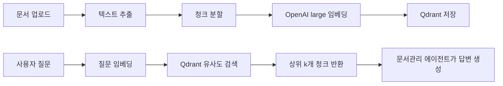

# RAG 임베딩 검색 방식

임베딩 검색은 **벡터 유사도 검색(RAG)** 방식입니다. 키워드 매칭이 아니라, 질문과 문서 청크를 같은 벡터 공간에서 비교합니다.

## 전체 흐름



## 1. 임베딩할 때 (인덱싱)

1. MinIO에서 문서 텍스트 추출 (md/txt/docx/hwpx/hwp)
2. `chunking.py`로 **1000자 단위, 200자 overlap** 으로 분할
3. OpenAI `text-embedding-3-large`로 각 청크를 **3072차원 벡터**로 변환
4. Qdrant에 저장 (사용자당 컬렉션 1개)

Qdrant에 저장되는 payload 예시:

```json
{
  "user_id": "...",
  "document_id": "...",
  "chunk_index": 0,
  "title": "문서 제목",
  "text": "실제 청크 내용..."
}
```

MySQL에는 **어떤 문서가 임베딩됐는지** 메타만 저장하고, 벡터는 Qdrant에만 둡니다.

## 2. 검색할 때

`search_embedded_documents` 도구 호출 시:

1. 질문을 `text-embedding-3-large`로 벡터화
2. 사용자의 Qdrant 컬렉션에서 검색
3. 상위 `top_k`개 청크 반환

관련 코드: `app/services/rag.py` → `search_embedded_documents`

Qdrant 검색은 **코사인 유사도** 기준입니다 (`app/services/vector_store.py` → `search_vectors`):

- 거리 측정: **Cosine similarity**
- 필터: **본인 `user_id`만** 검색 (다른 사용자 문서 제외)
- 추가 필터: MySQL에 **indexed 상태로 등록된 `document_id`만** 검색 (삭제된 문서 벡터 제외)
- 기본: **상위 5개 청크** (`top_k=5`, 최대 10)

## 3. 문서관리 에이전트가 하는 일

검색 결과는 이런 형태로 LLM에 전달됩니다:

```json
{
  "score": 0.85,
  "document_id": "...",
  "title": "문서 제목",
  "text": "관련 청크 내용..."
}
```

에이전트가 이 청크들을 근거로 답변을 만듭니다. **키워드 검색이 아니라 의미 기반 검색**이라 "permission 관련 에러"처럼 표현이 달라도 비슷한 내용을 찾을 수 있습니다.

## 요약

| 단계 | 기술 |
|------|------|
| 임베딩 모델 | OpenAI `text-embedding-3-large` (고정) |
| 벡터 DB | Qdrant |
| 검색 방식 | 코사인 유사도 + `user_id` 필터 |
| 청킹 | 1000자 / overlap 200자 |
| 결과 | 점수 높은 청크 top-k → LLM 답변 |

즉, **전통적인 LIKE/키워드 검색이 아니라, 질문·문서를 벡터로 바꿔 가장 가까운 청크를 찾는 방식**입니다.

## 관련 파일

| 파일 | 역할 |
|------|------|
| `app/services/chunking.py` | 텍스트 청크 분할 |
| `app/services/embeddings.py` | OpenAI 임베딩 API |
| `app/services/vector_store.py` | Qdrant upsert/search/delete |
| `app/services/rag.py` | 임베딩·검색 오케스트레이션 |
| `app/agents/tools/rag.py` | `search_embedded_documents` 도구 |
| `app/models/embedding.py` | MySQL 임베딩 인덱스·문서 메타 |
